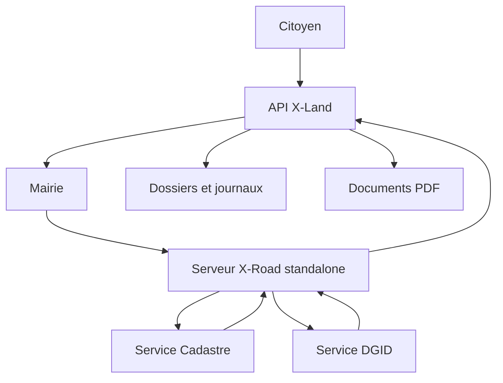

# X-Land API

**Prototype GovTech d'interopérabilité foncière au Sénégal**

X-Land est un prototype de plateforme de gestion et de régularisation foncière permettant de simuler le traitement d'un dossier entre un citoyen, une mairie, le cadastre et la DGID.

Le projet s'appuie sur une API backend et un serveur X-Road standalone pour expérimenter les échanges de données entre services institutionnels dans un environnement de démonstration.

## Objectifs

- Simplifier le parcours de régularisation foncière.
- Faciliter les échanges entre administrations.
- Assurer la traçabilité des demandes et des réponses.
- Générer des documents administratifs de démonstration.
- Préparer une architecture interopérable pour les futurs services X-Land.

## Architecture



Le serveur X-Road standalone constitue l'environnement d'échange du prototype. Les services institutionnels restent simulés : aucune connexion aux systèmes officiels du cadastre ou de la DGID n'est revendiquée.

## Fonctionnalités

- Création et suivi d'une demande foncière.
- Transmission d'une demande de NICAD au service cadastral simulé.
- Traitement des réponses positives ou des motifs de refus.
- Validation de la délibération par la mairie.
- Demande d'un acte foncier au service DGID simulé.
- Production des documents PDF.
- Journalisation des échanges interservices.

## Workflow métier

1. Le citoyen soumet sa demande avec les informations d'identification, les coordonnées du terrain et les pièces associées.
2. La mairie initie une demande de NICAD auprès du service cadastral via l'environnement X-Road.
3. Le cadastre simulé retourne un NICAD ou un motif de refus.
4. La mairie valide la délibération lorsque le NICAD est accepté.
5. Une demande d'acte est transmise au service DGID simulé.
6. Le dossier est mis à jour et les documents générés deviennent consultables.

## Structure du dépôt

- `main.py` : point d'entrée de l'application.
- `api_gateway.py` : composant de passerelle API.
- `config.py` : configuration.
- `routers/` : routes de l'API.
- `services/` : logique métier et services.
- `schema/` : schémas de données.
- `database/` : gestion des données.
- `middleware/` : traitements intermédiaires.
- `blockchain/` : composants liés à la simulation blockchain.
- `tests/` : tests du prototype.
- `testservice_api.yaml` : description d'un service de test.

## Installation

Prérequis :

- Python et environnement virtuel.
- Dépendances du projet.
- Serveur X-Road standalone configuré et accessible.
- Services de test nécessaires au scénario de démonstration.

```bash
git clone https://github.com/ouzlaye/X_Land_api.git
cd X_Land_api
python3 -m venv .venv
source .venv/bin/activate
pip install -r requirements.txt
```

Configurer ensuite les paramètres de connexion au serveur X-Road et aux services exposés conformément à l'environnement de démonstration.

## API métier

| Méthode | Endpoint | Fonction |
|---|---|---|
| POST | `/api/citizenRequest/{id}/demandeNICAD` | Demande de NICAD |
| POST | `/api/citizenRequest/{id}/validerDeliberation` | Validation de la délibération |
| POST | `/api/citizenRequest/{id}/demandeActe` | Demande d'acte foncier |
| GET | `/api/citizenRequest/{id}` | Suivi du dossier |

Les données de démonstration sont conservées dans les fichiers du prototype. Les échanges sont journalisés dans `xroad_logs.json`.

## Perspectives

- Industrialisation du déploiement X-Road.
- Authentification et contrôle d'accès par institution.
- Traçabilité renforcée des transactions.
- Extension vers X-RaaS (X-Road as a Service).
- Intégration cartographique et interopérabilité avec les systèmes fonciers nationaux.

## Statut du projet

Prototype de démonstration GovTech. Les services administratifs, les actes et les identifiants fonciers utilisés dans les scénarios sont simulés. Le projet n'est pas un système cadastral officiel et ne produit aucun acte juridiquement opposable.

## Auteur

Projet X-Land — [GitHub](https://github.com/ouzlaye/X_Land_api)
